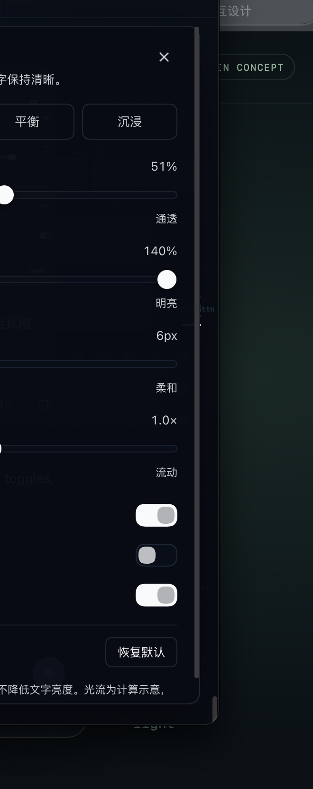
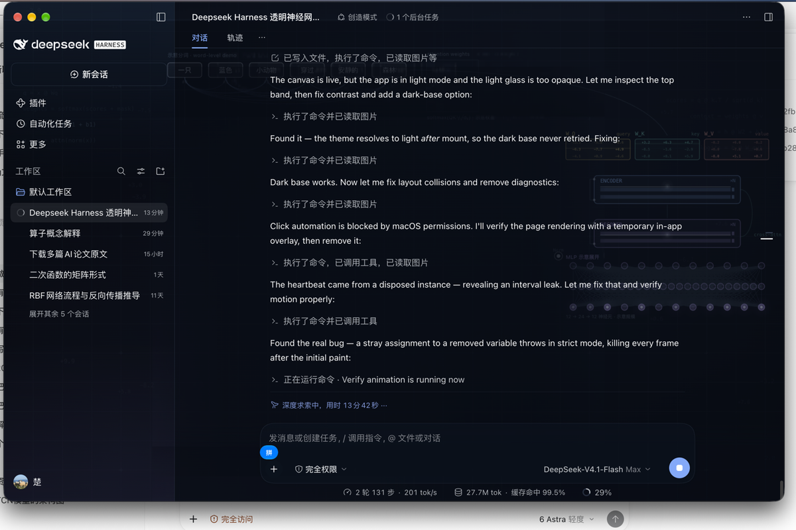
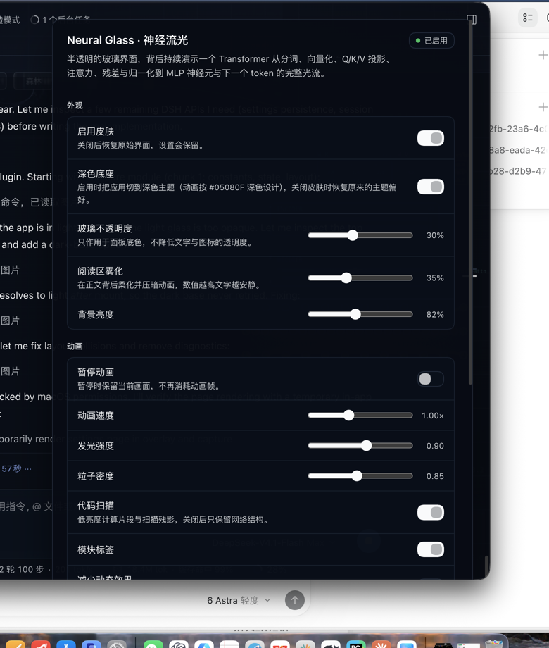

# Neural Glass · 神经流光

> 把 DeepSeek Harness 变成一块悬浮在 Transformer 神经网络之上的透明玻璃工作台。
> 界面半透明，背后持续演示一条完整的计算光流：**句子 → token → 向量 → Q/K/V → 注意力 → 残差与归一化 → MLP 神经元 → 下一个 token**。



## 特性

- **一条 24 秒循环、无跳切的光流**：token 卡片、10 维向量采样、`W_Q/W_K/W_V` 投影矩阵、跨 token 的贝塞尔注意力弧线、6×6 权重矩阵（Decoder-only 时带因果遮罩）、Encoder/Decoder 模块、逐个画出的 **12 → 24 → 12 个圆形 MLP 神经元**、输出概率条、token 回流衔接下一轮。
- **玻璃界面**：只把面板底色的 alpha 调低（`--dsw-alias-bg-base` 等 token），不对容器用 `opacity`，文字与图标保持满对比度。
- **可读性遮罩**：正文列背后局部压暗 + 可选雾化，屏幕边缘的结构保持清晰。
- **浮动 Neural Glass 面板**：专注 / 平衡 / 沉浸三档预设、界面透明度、背景光效、玻璃模糊、动画速度、启用/暂停、开场淡入、恢复默认、关闭按钮（Esc 也可关）。
- **输入框旁的紧凑控制**：模型选择器左侧一条背景浓度滑杆 + 星形按钮（打开面板）。
- **启动动画**：应用启动时先以满强度播放完整开场，9 秒内平滑淡到安静背景（可在面板里关掉）。
- **两种结构模式**：经典 Encoder–Decoder（默认）与 Decoder-only；另有深色底座、跟随会话状态驱动、质量档位、减少动态效果。
- **干净卸载**：关闭皮肤会移除画布、玻璃层与主题覆盖，并恢复原来的主题偏好。



## 安装到 DeepSeek Harness

1. 准备这个仓库的本地目录（`git clone`，或直接在 GitHub 页面 **Code → Download ZIP** 解压）。
2. 打开 DeepSeek Harness → **设置 → 插件 → 添加插件**，选择本目录（包含 `package.json` 的那个文件夹）。
   - 也可以用插件管理器安装：`plugin_manager` 的 `install_bundle`，目标是本目录的绝对路径。
3. 启用后即可看到效果。入口有两个：
   - **设置 → 神经流光**（完整设置页）
   - **侧边栏左下角的星形按钮**，或**输入框模型选择器旁的星形按钮**（浮动面板）

要求：DeepSeek Harness 的 Web GUI（桌面版内置）。包名：`@local/neural-glass`。

> 安装是"链接本地目录"的方式，改代码后到插件列表里禁用再启用即可重新加载，不需要打包构建。

## 使用

| 控件 | 作用 |
| --- | --- |
| 专注 / 平衡 / 沉浸 | 一键切换透明度、光效、模糊、速度、粒子、发光、代码扫描 |
| 界面透明度 | 面板底色 alpha（显示叠加后的有效透明度） |
| 背景光效 | 背景动画明暗，0–100% |
| 玻璃模糊 | 阅读区雾化强度（显示为 px） |
| 动画速度 | 0.4× – 2× |
| 启用动态背景 | 关掉即移除画布/玻璃层并恢复原主题，面板仍可再打开 |
| 暂停动画 | 冻结当前画面，不再消耗动画帧 |
| 开场淡入 | 启动时先播完整动画再淡入背景 |

设置自动保存在本机（localStorage，键名 `neural-glass:settings:v1`），卸载插件不会自动清除。



## 设计说明

四层结构：**底色**（#05080F 深蓝黑）→ **环境**（极淡网格、稀疏权重数字、阶段性代码扫描残影）→ **结构**（token、向量、QKV 矩阵、注意力弧线、模块、神经元）→ **数据**（沿路径移动的光点与节点激活）。颜色语义固定：金黄 Q、青绿 K、珊瑚 V、冰蓝注意力输出、淡紫 MLP、蓝灰静态连线。

- 数据传导有明确因果：匹配（弧线）与聚合（V 汇入）分开表现，MLP 按层错峰激活，只有部分连线同时亮起。
- 画布是 `body` 底层 `z-index:-1` 的单张 canvas，不拦截鼠标事件；页面隐藏时暂停；支持低/中/高质量档位。
- 调试接口：控制台 `window.__NEURAL_GLASS__`（`getSettings` / `patch` / `reset` / `setState`）。

## 限制

- 背景动画是**示意数据**：分词、注意力权重、MLP 维度都是演示值，不是模型内部真实计算。
- 这里的"透明"指**应用内面板**能透出动画，不是操作系统窗口透明。
- **深色底座默认开启**：启用期间应用保持在深色主题（动画按 #05080F 设计），关闭皮肤时恢复你原来的主题偏好；不需要可在面板/设置里关掉。
- 画布内的标签目前固定中文；浅色主题有适配但未做完整目视验证。

## 文件结构

```
client.js          # 全部逻辑：场景绘制、玻璃 token 层、面板、设置页、状态桥（单文件，无构建）
index.js           # Host 半身（空实现，只是让 bundle 行可加载）
cordis.patch.yml   # 插入 Loader 行 neural-glass
package.json       # dsh.bundle.patch + dsh.client（platform: web）
locale/{en,zh}.json# 插件市场里的标题/描述/详情
docs/              # 插件详情页 + 预览图
icon.svg           # 插件图标
screenshots/       # 本 README 用的截图
UPLOAD.md          # 如何上传到 GitHub（中文步骤）
```

## 开发

- 纯 JavaScript，无打包步骤；`node --check client.js` 可在提交前做语法检查。
- 修改后在 DSH 插件列表里禁用再启用即可加载新代码（未运行 `pnpm run dev:web` 时不会热更新）。
- 关键常量都在 `client.js` 顶部：`DEFAULTS`（默认设置）、`PRESETS`（三档预设）、`INK`（两套配色）、`computeLayout`（响应式布局）。

## English

A skin plugin for DeepSeek Harness: translucent glass panels over one continuous, 24-second Transformer data-flow animation (tokens → embeddings → Q/K/V → multi-head attention → residual & norm → 12→24→12 drawn MLP neurons → next token). Includes a floating control panel with three presets, transparency/glow/blur/speed sliders, enable/pause/intro switches, Encoder–Decoder and Decoder-only structure modes, and a compact slider in the composer row. Installs as a local DSH plugin bundle (Settings → Plugins → Add plugin). The animation is illustrative — tokenization, attention weights and MLP widths are demo data, not model telemetry. Transparency means in-app panels show the canvas; it does not make the OS window transparent.

## License

[MIT](LICENSE)
